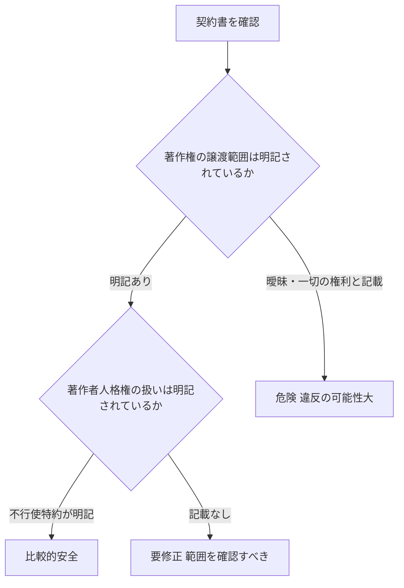

# 成果物の著作権は誰に?業務委託契約の著作権譲渡条項の注意点

**メタディスクリプション：** 業務委託契約書の著作権譲渡条項を放置すると成果物の権利を失います。著作者人格権不行使特約の危険性と条文根拠を解説。

---

## 共感の冒頭(ユーザーの状況描写)

Webデザイナーとして独立して2年目。先日納品したロゴデザインが、クライアントの別事業で勝手に改変されて使われていることに気づきました。契約書を見返すと「成果物に関する一切の権利は甲に帰属する」という一文があります。こんな抽象的な条項にサインした覚えはあるものの、まさか自分の作品がどう使われても文句を言えない契約だったとは思いませんでした。

ロゴ、イラスト、記事、プログラムコード、デザイン案——フリーランスが生み出す成果物には「著作権」と「著作者人格権」という2つの権利が存在します。この違いを理解せずに契約書にサインすると、取り返しのつかない事態になります。

## 結論(断定)

業務委託契約における著作権譲渡条項は、譲渡する権利の範囲を具体的に明記する義務があります。「一切の権利」という曖昧な表現は著作者にとって著しく不利であり、著作者人格権は譲渡自体が法律上不可能です(著作権法第59条)。発注者が著作者人格権まで放棄させようとする場合は「著作者人格権を行使しない」という不行使特約の形を取りますが、この特約の範囲が不明確な契約は、フリーランス新法第3条が定める取引条件の明示義務に抵触する可能性が高い契約です。

> **[→ 登録不要・無料で契約書を1回AI診断する(条文番号付きで違反箇所を特定)](https://freelance-contract-checker.vercel.app/try)**

## 著作権と著作者人格権の違いを理解する

著作権(財産権)は譲渡可能な権利で、複製権・公衆送信権・翻案権などが含まれます(著作権法第21条〜第28条)。一方、著作者人格権は著作者の人格的利益を保護する権利で、公表権(第18条)・氏名表示権(第19条)・同一性保持権(第20条)の3つから構成されます。

🚨 <strong>違反リスク</strong> 著作者人格権は「譲渡」できません(著作権法第59条)。「著作者人格権も含め一切の権利を譲渡する」という契約条項は法律上無効な記載であり、実務上は「著作者人格権を行使しない」という不行使特約として扱われます。

この違いを知らないまま契約書にサインすると、以下のような事態が起こります。

| 権利の種類 | 譲渡の可否 | 典型的なトラブル |
|---|---|---|
| 著作権(財産権) | 譲渡可能 | 二次利用・転売で収益を得られない |
| 著作者人格権 | 譲渡不可 | 無断改変・名前を消される |

## 「一切の権利」条項が危険な理由

契約書によく見られる「成果物に関する一切の権利は甲(発注者)に帰属する」という文言は、以下の問題を含んでいます。

- 譲渡対象の著作権の範囲(複製権のみか、翻案権まで含むか)が不明
- 著作者人格権の不行使特約が含まれるのか不明
- 納品前の試作品・没案の権利まで譲渡対象になっているか不明
- 対価が著作権譲渡の対価を含んでいるか不明

フリーランス新法第3条では、業務委託事業者に対し、給付の内容・報酬の額とともに「成果物に係る知的財産権の取扱い」を書面またはメールなど明示できる方法で示す義務を課しています。著作権の帰属があいまいな契約書は、この明示義務を実質的に満たしていない契約だと判断されます。

⚠️ <strong>注意</strong> 著作権譲渡の対価が通常の業務委託報酬に含まれているのか、別途発生するのかが契約書に明記されていない場合、後から「著作権譲渡分の追加報酬」を請求する根拠が失われます。

## 契約書チェックリストで確認すべき項目

著作権譲渡条項を確認する際は、以下の項目を1つずつチェックしてください。

✅ <strong>チェックポイント</strong> 
1. 譲渡される権利の種類が具体的に列挙されているか(複製権・翻案権・二次的著作物の利用権など) 
2. 著作者人格権について「不行使特約」が明記されているか、範囲は限定的か 
3. 著作権譲渡の対価が報酬に含まれるか別途発生するかが明記されているか 
4. 納品前の試作品・ボツ案の権利帰属が明記されているか 
5. 契約解除時の権利の扱いが明記されているか

著作権譲渡の対価について、フリーランス新法第5条第7号では「給付の内容について著しく不十分な対価による取引」を禁止しています。著作権譲渡の対価が実質ゼロに等しい契約は、この規定に抵触する可能性のある契約です。また下請法第4条第1項第5号の買いたたき規定も同様の趣旨を持っており、著作権という本来価値のある権利を無償同然で譲渡させる契約は、法的に問題視される取引です。

> **[→ 今の契約書の違反リスクを30秒で確認する](https://freelance-contract-checker.vercel.app/try)**

## 不行使特約への対応方法

著作者人格権の不行使特約自体は、契約実務上広く用いられており、それ自体が直ちに違法というわけではありません。しかし、以下のような無限定な不行使特約は、著作者にとって著しく不利な内容です。

- 「著作者人格権を一切行使しない」という範囲限定のない記載
- 氏名表示権まで放棄させ、作品に自分の名前を一切出せなくする条項
- 同一性保持権まで放棄させ、作品を原形をとどめないほど改変されても抗議できない条項

📋 <strong>まとめ</strong> 
著作権譲渡条項では「何を」「どこまで」譲渡するのかを具体的に特定する義務が発注者側にあります。著作者人格権は譲渡できない権利であり、不行使特約の範囲も限定的に交渉すべきです。曖昧な「一切の権利」条項はフリーランス新法第3条の明示義務違反の可能性があります。

## 今すぐできること

手元にある契約書の著作権条項を開き、「一切の権利」「著作者人格権」という文言があるかどうかを確認してください。該当する場合は、その条項が譲渡範囲を具体的に特定しているか、対価が明記されているかを1つずつ照らし合わせる必要があります。

自分の目だけで条文違反を見抜くのは困難です。無料診断ツールに契約書をアップロードすれば、条文番号付きで違反箇所を特定できます。

> **[→ 無料で1回、契約書を守る(登録不要・専門知識不要)](https://freelance-contract-checker.vercel.app/try)**