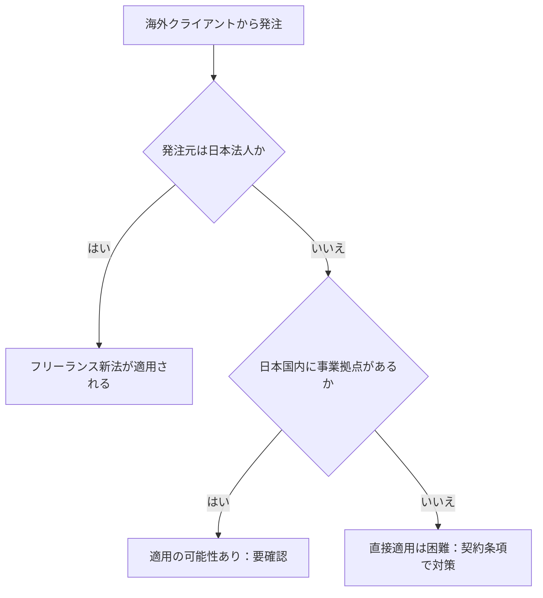

# 海外クライアントとの契約にもフリーランス新法は適用される？

**メタディスクリプション：** 海外企業から業務委託を受けるフリーランスは要注意。フリーランス新法の適用範囲を条文根拠とともに解説します。

---

## 共感の冒頭

シンガポールのスタートアップから直接DMが来て、英語の契約書にサインした。報酬は米ドル建て、支払いはPayPal。最初は喜んでいたものの、納品から2ヶ月経っても支払いがなく、問い合わせても「来月には」の繰り返し。

「相手は海外の会社だから、日本の法律は関係ないんですよね…？」

そう思って泣き寝入りしかけている方へ。結論から言うと、その判断は早計です。

## 結論（断定）

フリーランス新法は、**発注事業者が日本国内で事業を行っている場合、委託先が海外企業であっても、または受注者が海外に住んでいても、一定の条件下で適用されます。**逆に、発注事業者自体が完全な海外法人で日本国内に事業拠点を持たない場合は、フリーランス新法の直接適用は困難です。この違いを理解していないと、本来守られるべき権利を主張できません。

> **[→ 登録不要・無料で契約書を1回AI診断する（条文番号付きで違反箇所を特定）](https://freelance-contract-checker.vercel.app/try)**

## フリーランス新法の適用範囲はどう決まるのか

フリーランス新法（特定受託事業者に係る取引の適正化等に関する法律）第2条では、「特定業務委託事業者」を定義していますが、国籍や所在地による除外規定はありません。重要なのは、**発注事業者が日本法人であるか、日本国内で事業活動を行っているか**という点です。

💡 <strong>ポイント</strong> 法律の適用は「契約の準拠法」だけでなく「発注事業者の事業実態」で判断されます。日本法人の海外支社から発注された場合も、本社が日本にあれば適用対象になり得ます。

一方、下請法（下請代金支払遅延等防止法）第2条でも同様に、親事業者が日本国内で資本金要件を満たす事業者であることが適用の前提です。海外企業が直接日本のフリーランスに発注する場合、この要件を満たさないケースが大半です。

## 「海外企業＝適用外」ではない具体例

以下のケースで整理すると分かりやすくなります。

| 発注元の実態 | 適用の可能性 |
|---|---|
| 日本法人（海外展開中） | 適用される（第2条） |
| 日本法人の海外子会社が直接契約 | ケースバイケース |
| 完全な海外法人（日本に拠点なし） | 原則適用外 |

⚠️ <strong>注意</strong> 契約書に「準拠法：シンガポール法」などと記載されていても、発注事業者が実質的に日本で事業を営んでいれば、フリーランス新法の趣旨から保護の対象となる可能性を主張できます。契約書の準拠法条項だけで諦める必要はありません。

さらに、フリーランス新法第3条では、業務委託の内容を書面またはメールで明示する義務が発注事業者に課されています。海外企業であっても、日本国内に代理店や連絡窓口を置いて日本人フリーランスに継続発注している場合、この義務が及ぶと解釈されます。

## 適用外でも泣き寝入りしない方法

発注元が完全な海外法人で法律の直接適用が困難な場合でも、対策はあります。契約締結前に、以下の条項を必ず契約書に盛り込むことが重要です。

✅ <strong>チェックポイント</strong> 
・支払期日の明記（フリーランス新法第4条の趣旨を準用） 
・準拠法・裁判管轄の確認（日本法・日本の裁判所を指定できないか交渉） 
・報酬の通貨と為替リスクの負担者を明記 
・契約不履行時の違約金条項の設定

特に下請法第4条で禁止されている「支払遅延」「報酬の減額」「不当なやり直し」などの行為は、海外企業であっても契約書に同様の禁止条項を盛り込むことで、実質的に自分を守ることができます。法律が直接適用されないからこそ、契約書の文言そのものが唯一の武器になるのです。

> **[→ 今の契約書の違反リスクを30秒で確認する](https://freelance-contract-checker.vercel.app/try)**

## 国際取引だからこそ契約書の精査が重要

国内クライアントとの取引であれば、フリーランス新法や下請法という「最低限のセーフティネット」が機能します。しかし海外クライアントとの取引では、このセーフティネットが及ばないケースが多く、**契約書そのものがすべての拠り所**になります。

🚨 <strong>違反リスク</strong> 海外企業との契約書に支払期日の記載がない、または「検収完了後」とだけ曖昧に記載されている場合、支払いを無期限に引き延ばされるリスクがあります。これは国内取引であればフリーランス新法第4条違反となる典型例です。

契約書を結ぶ前に、発注元の事業実態（日本法人か、海外法人か、日本に拠点があるか）を確認し、それに応じた契約条項を準備する必要があります。この確認と条項設計を自己判断で行うのは、専門知識がない限り非常に困難です。

📋 <strong>まとめ</strong> 
・発注元が日本法人ならフリーランス新法は適用される（第2条） 
・完全な海外法人は直接適用が困難だが、契約書で対策可能 
・支払期日・準拠法・為替リスクの明記が必須 
・契約前の確認が何より重要

## 今すぐできること1つ

海外クライアントとの契約書にサインする前に、発注元の事業実態を確認し、支払条件と準拠法の条項を今一度見直してください。自分一人での判断に不安がある場合は、契約書をそのままAIで診断することで、条文番号付きで違反リスクやリスク条項を特定できます。

> **[→ 無料で1回、契約書を守る（登録不要・専門知識不要）](https://freelance-contract-checker.vercel.app/try)**